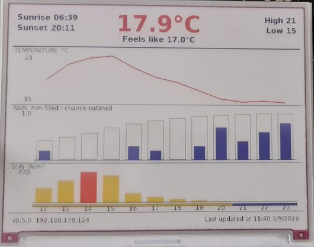

# esp32-wx-station

A twelve-hour weather forecast on a seven-colour e-paper panel, driven by a XIAO
ESP32-C3 & updated over the air from a server you own. No cloud account, no API key & no
phone application: the device fetches its own forecast over HTTPS, draws it, & sleeps
until the next hour.

The panel shows the current temperature & what it feels like, today's sunrise & sunset,
the twelve-hour high & low, & three stacked charts — temperature, rainfall against the
chance of rain, & sunlight — over a strip that says which of those hours are night.



## Hardware

| Part | Notes |
|---|---|
| Seeed XIAO ESP32-C3 | 4 MB flash, 400 KB SRAM, **no PSRAM**. The absence of PSRAM is what forces banded rendering: a whole 600 × 448 frame is 268 800 bytes & does not fit |
| Pimoroni Inky Impression 5.7" (PIM534) | 600 × 448, seven colours, UC8159 controller, ~30 s refresh. Pimoroni have discontinued it in favour of the 7.3" (PIM773); PLAN §8 covers what changes |
| 40-pin header breakout | The panel's connector is a female socket meant to swallow a Raspberry Pi header. Jumper wires into a socket are miserable |

Nine wires, & the pin assignments are in PLAN §3b. One of them is a trap: SCLK lands on
GPIO 8, which is a strapping pin on this chip.

## Requirements

- ESP-IDF v6.0.2 (v6.0.x). Earlier branches will not build: several APIs moved in v6
- For OTA updates a host serving static files over HTTPS, for updates. Any static file server will do;
  [`nas/README.md`](nas/README.md) documents a Synology running `nginx` in a container
- Linux or macOS. Windows via WSL2, untested here

## Install & first run

```bash
cp sdkconfig.local.example sdkconfig.local     # then edit it
./tools/gen_signing_key.sh
./tools/gen_certs.sh <hostname> <ip>
idf.py set-target esp32c3 && idf.py build flash monitor
```

Where:

- `sdkconfig.local` holds the site-specific settings & the secrets. It is gitignored; the
  tracked `.example` beside it is the shape, & carries no real values
- `gen_signing_key.sh` writes `keys/`, also gitignored. **Lose that key & no device signed
  with it can ever be updated over the air again**
- `<hostname>` must be the name the device will dial for firmware, & must appear in the
  certificate's Subject Alternative Name list

> **Set `CONFIG_APP_CFG_AP_PASS_SALT` in `sdkconfig.local` before commissioning a board.**
> The provisioning passphrase is derived from the salt & the device MAC, & the MAC is
> advertised in the setup SSID. On the tracked default salt — which is published with this
> repository — anyone who can see the SSID can compute the passphrase.

On first boot the device has no credentials, so it raises a WPA2-protected setup network &
prints the passphrase to the serial console. Join it from a phone, pick a network in the
captive portal, & the device reboots onto the LAN. The forecast location is settable from
the same page.

## What is on the panel

| Band | Contents |
|---|---|
| Header | Current temperature, "Feels like" beneath it, sunrise & sunset left, twelve-hour high & low right, a stale marker when the forecast is old |
| Temperature | A line over twelve hours, annotated with the range |
| Rain | Millimetres as filled bars, the chance of rain as an outline behind them |
| Sun | Shortwave radiation in W/m², peak hour picked out in orange |
| Footer | Version, IP address, & when the forecast was fetched |

The panel redraws hourly, & only when the frame has actually changed: a redraw is 30
seconds of visible flashing, so an unchanged forecast is not worth one. A clean cycle runs
weekly. Manual refreshes — button A, `POST /api/refresh`, or the MQTT `refresh` command —
are rate-limited to three minutes & a refusal is reported rather than swallowed.

Forecasts come from [Open-Meteo](https://open-meteo.com/), which needs no key & no
account. The query & the reasoning behind each variable are in PLAN §4a.

## Updating over the air

A device polls a static HTTPS server for a manifest, verifies four independent things
about the image it names, installs it, boots it on probation, & puts the previous image
back if the new one cannot prove itself. Only a release that parses as `vX.Y.Z` & sorts
strictly above what is running installs itself automatically.

See [Publish an update](docs/publish-an-update.md) for the whole loop, & [Command a
fleet](docs/fleet-commands.md) for the optional MQTT link.

Trust is deliberately split in two: a private certificate authority for the firmware
server, which is on the LAN & has no public name, & the IDF root bundle for Open-Meteo,
which is on the public internet. Both connections are verified; they simply answer to
different anchors. PLAN §1a is the argument.

## Components

`main/` holds four lines. Everything else sits behind a component interface.

| Component | Responsibility |
|---|---|
| `app_core` | Bring-up order, & the glue between components |
| `app_cfg` | Device identity & NVS-backed configuration, plus factory reset |
| `app_diag` | Version, slot, boot count, reset reason, rollback state, crash dumps |
| `app_trust` | The single answer to which certificate authority the device believes |
| `app_net` | Wi-Fi state machine, SoftAP fallback, SNTP, mDNS |
| `app_httpd` | Status page, JSON control surface, provisioning portal, captive DNS |
| `app_ota` | Manifest fetch, version policy, TLS download, rollback self-test |
| `app_mqtt` | Optional broker link: fleet-wide commands & telemetry. Off by default |
| `app_led` | Sole owner of the status LED: patterns & manual override |
| `app_epd` | The UC8159 panel: nine registers, banded transfer, controller sleep |
| `app_gfx` | Banded surfaces, clipping, primitives & 1-bit fonts. No I/O |
| `app_ui` | The layout. Forecast in, drawing calls out. No I/O, no clock |
| `app_wx` | The forecast: the HTTPS fetch, the parser, & the NVS cache |
| `app_display` | Owns the panel: when to redraw, what to skip, the clean cycle |
| `app_btn` | The panel's three buttons, debounced |

`app_gfx`, `app_ui` & the `app_wx` parser do no I/O at all, which is what lets the layout
be iterated against a file rather than against a 30-second panel refresh.

## Tests

```bash
./tools/run_tests.sh
# → 447 checks, 0 failed
# → all tests passed
```

Host-only, no toolchain & no hardware. It covers the units whose bugs are silent on a
device: the forecast parser against a recorded response, the layout's band seams, JSON
escaping, DNS reply packing, update policy, rollback accounting, digest comparison, MQTT
command parsing, & the three build-time guards.

The seam test is the one that matters: rendering fourteen 32-row bands must produce
exactly the bytes that rendering one 448-row surface would, & it was confirmed failing
against deliberately broken code before being trusted.

```bash
make -C test/host preview && xdg-open /tmp/wx-ok.ppm
```

Renders every screen to a file so the layout can be looked at rather than reasoned about.
Deliberately not a test — three real layout bugs were found this way in the first ten
minutes of having it.

## What it does not do

- **No cloud & no phone application.** The device talks to Open-Meteo & to a server you run
- **No authentication on the device's own web interface.** Anyone who can reach the board
  can restart it. Compile it out with `CONFIG_APP_HTTPD_ENABLE=n` before putting it on a
  network that is not yours
- **No hardware secure boot, flash encryption or anti-rollback.** All three burn eFuses
  irreversibly & are left off deliberately; image signing gives most of the benefit & can
  be undone
- **No delta updates.** Every update transfers the whole image
- **No battery operation.** The panel needs a 5 V rail it cannot supply itself, & OTA
  polling, mDNS & the status page all assume a device that is awake

## Getting help & contributing

Open an issue with the board, the ESP-IDF version & the serial log from boot. Run
`./tools/run_tests.sh` & `./tools/build_matrix.sh` before proposing a change.

## Licence

MIT — see [LICENSE](LICENSE).

The generated font tables in `components/app_gfx/font_*.c` are glyph bitmaps derived from
the DejaVu fonts & carry their own notice; see
[`components/app_gfx/FONT-LICENCE.txt`](components/app_gfx/FONT-LICENCE.txt).
